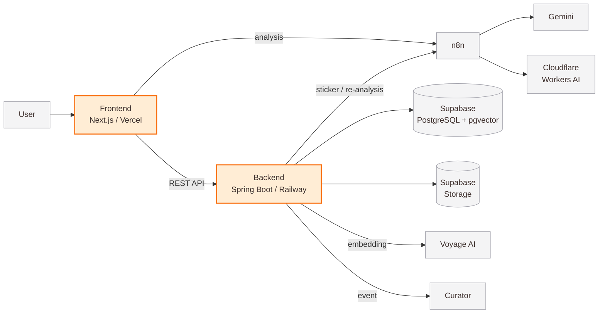
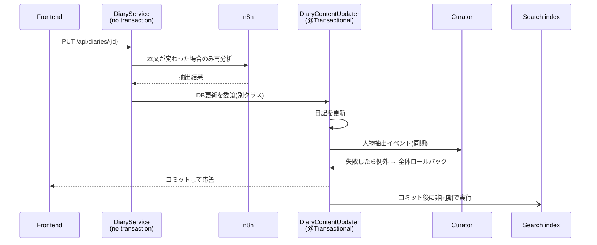
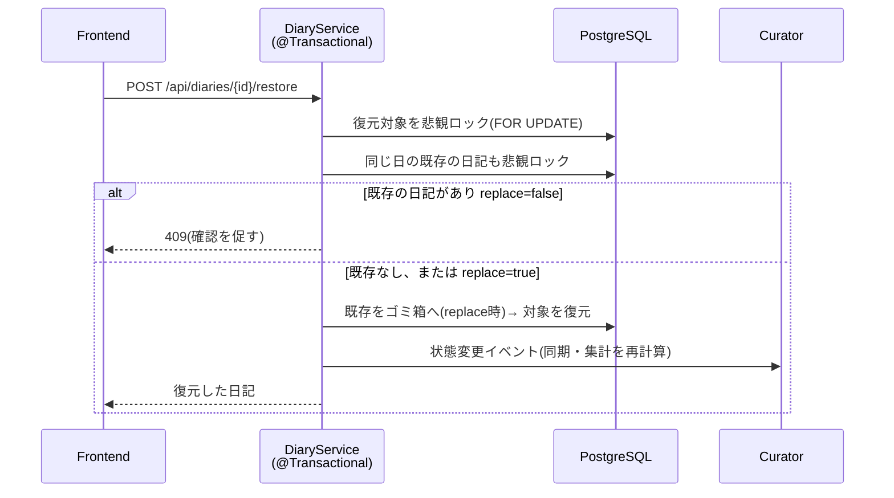

<p align="center">
  
</p>

<h3 align="center">AI絵日記サービス</h3>

<p align="center"><b>日記を書くと、AIが一日を1枚のステッカーにして残してくれる</b></p>

<p align="center">カレンダー・日記 担当 ｜ チーム開発(5名・約2ヶ月)</p>

<p align="center">
  
  
  
  
  
  
  
  
</p>

<p align="center">
  <a href="https://tada-frontend-seven.vercel.app/"><b>▶ Demo</b></a> ・
  <a href="https://github.com/idlms9/tada-frontend"><b>Frontend</b></a> ・
  <a href="https://github.com/idlms9/tada-was"><b>Backend</b></a>
</p>

<p align="center">
  
</p>

<p align="center">メイン画面(日付ごとにステッカーが貯まる月間カレンダー)</p>

## 私の担当

<table>
  <tr>
    <td width="170"><b>🖥️ フロントエンド</b></td>
    <td>
      ・月間カレンダー画面(CSS Grid自作・年月ピッカー)<br>
      ・日記の作成・詳細モーダル<br>
      ・ゴミ箱パネルとドラッグ&amp;ドロップ削除<br>
      ・API連携・エラー処理
    </td>
  </tr>
  <tr>
    <td><b>⚙️ バックエンド</b></td>
    <td>
      ・日記CRUD API(作成・取得・更新・ゴミ箱・復元)<br>
      ・カレンダーAPI(月別のステッカー取得)<br>
      ・30日後の自動削除バッチ、未使用画像の自動清掃<br>
      ・AI再分析の連携(本文更新時)<br>
      ・人物認識(Curator)との同期イベント連携
    </td>
  </tr>
</table>

## 設計で考えたこと

<table>
  <tr>
    <td width="250"><b>🛡️ 中途半端を残さない</b></td>
    <td>日記・ステッカー・人物認識を<br>1つのトランザクションで保存し、<br>失敗したらDB変更を全て取り消す</td>
  </tr>
  <tr>
    <td><b>🔄 安心して使える</b></td>
    <td>1日1件・新規作成は1日5回まで<br>消してもゴミ箱から戻せる<br>戻す日に日記があれば確認して入れ替え</td>
  </tr>
  <tr>
    <td><b>⏱️ DBを占有しない</b></td>
    <td>AIの呼び出しはトランザクションの外で行い、<br>結果を検証してから<br>短いトランザクションで保存する</td>
  </tr>
</table>

## アーキテクチャ

### システム構成



<table>
  <tr>
    <td width="150"><b>🟠 オレンジ</b></td>
    <td>私の担当(画面、日記・カレンダーAPI)</td>
  </tr>
  <tr>
    <td><b>⚪ グレー</b></td>
    <td>チームの他のメンバーの担当<br>(AI処理・DB・インフラ・人物認識など)</td>
  </tr>
</table>

私が実装したのは、バックエンドからn8nを呼び出す連携部分と、人物認識へイベントを渡す部分です。
画面は1つのページに、モーダルやパネルを重ねる構成です(ページ遷移なし)。

### 日記を更新するときの流れ



<table>
  <tr>
    <td width="150"><b>🔗 人物認識</b></td>
    <td>同じトランザクションで実行<br>失敗したら日記の更新も取り消される<br>(対象はDB変更のみ)</td>
  </tr>
  <tr>
    <td><b>✅ 検索用データ</b></td>
    <td>コミット後に実行<br>失敗しても日記の保存には影響しない</td>
  </tr>
</table>

### ゴミ箱から復元するときの流れ



<table>
  <tr>
    <td width="150"><b>🔁 入れ替え</b></td>
    <td>既存をゴミ箱へ送る処理と復元を<br>1つのトランザクションで実行<br>途中で失敗しても中途半端にならない</td>
  </tr>
  <tr>
    <td><b>🗑️ 完全削除</b></td>
    <td>利用者の操作では行わない<br>30日経過後に自動削除バッチが実行</td>
  </tr>
</table>

## 担当API

| メソッド | パス | 内容 |
|---|---|---|
| POST | /api/diaries | 日記の最終保存 |
| GET | /api/diaries/{id} | 日記の取得 |
| PUT | /api/diaries/{id} | 日記の更新 |
| DELETE | /api/diaries/{id} | ゴミ箱へ移動 |
| POST | /api/diaries/{id}/restore | ゴミ箱から復元 |
| GET | /api/diaries/trash | ゴミ箱の一覧 |
| GET | /api/diaries/can-create | 作成可否の確認 |
| POST | /api/diaries/generate-sticker | ステッカー生成 |
| DELETE | /api/diaries/{id}/permanent | 完全削除(画面なし) |
| GET | /api/calendar | 月別のステッカー取得 |

## 課題と対応

### ① @Transactionalが効かない

<table>
  <tr>
    <td width="90"><b>🔴 問題</b></td>
    <td>本文更新で、AI再分析の待ち時間も<br>DB接続を占有する恐れ</td>
  </tr>
  <tr>
    <td><b>🟡 原因</b></td>
    <td>同じクラス内の呼び出しでは<br><code>@Transactional</code> が効かない(プロキシを通らない)</td>
  </tr>
  <tr>
    <td><b>🔵 対応</b></td>
    <td>DB更新を別クラス(<code>DiaryContentUpdater</code>)に分け、<br>AI呼び出しはトランザクションの外へ</td>
  </tr>
  <tr>
    <td><b>🟢 結果</b></td>
    <td>AI待ちでDBを占有せず、<br>人物認識が失敗したら更新も取り消される</td>
  </tr>
</table>

### ② 復元の同時操作(排他制御)

<table>
  <tr>
    <td width="90"><b>🔴 問題</b></td>
    <td>「確認→復元」の間に別の操作が入ると、<br>制約違反エラーになる恐れ</td>
  </tr>
  <tr>
    <td><b>🟡 原因</b></td>
    <td>確認と復元の間に、別の処理が入る余地があった<br>(レビューで発見)</td>
  </tr>
  <tr>
    <td><b>🔵 対応</b></td>
    <td>復元する日記と、同じ日の既存の日記に<br>悲観ロック(FOR UPDATE)をかけた</td>
  </tr>
  <tr>
    <td><b>🟢 結果</b></td>
    <td>同時に操作しても、エラーにならず<br>日記は1件のまま(DB制約とロックの二重で防御)</td>
  </tr>
</table>

## テスト

| 対象 | 検証内容 | 件数 |
|---|---|---:|
| DiaryService | 作成・更新・ゴミ箱・復元 | 18 |
| DiaryContentUpdater | 本文更新・イベント発行 | 5 |
| StickerCleanupService | 未使用画像の清掃 | 5 |
| StickerObjectCleanupClient | ストレージ連携 | 5 |
| DiaryAnalysisClient | n8n連携 | 3 |

JUnit・Mockitoで作成。実行:`./gradlew test`

## ディレクトリ構成

```
バックエンド  src/main/java/com/tada/tada/
├── global/     設定・セキュリティ・共通例外・イベント
├── auth/       ログイン・トークン
├── diary/      日記(私の担当)
├── calendar/   カレンダー(私の担当)
├── search/     検索
└── curator/    人物認識

フロントエンド  domains/
├── calendar/ diary/ sticker/ search/ curator/ auth/ guest/
└── shared/     共通部品(api-client, token-store など)
```
